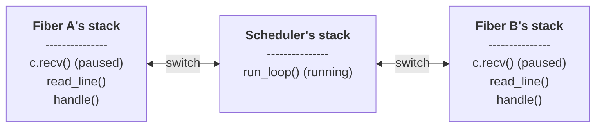

# coroutine runtime

A stackful coroutine runtime on Linux that lets you write plain blocking-style code in lightweight user threads, with io_uring handling the I/O

## Features
- Lightweight user threads (fibers) multiplexed on a single OS thread
- io_uring for socket and file I/O
- Timers (`c.sleep(duration)`)
- Go-inspired concurrency primitives: buffered channels, `select` over multiple channels, semaphores

## Limitations
- Single-threaded
- Channels must be buffered
- `select` only supports receive branches
- No cancellation support for now
- Fixed-size stack per fiber

## How: stack switching
Each connection runs in a fiber: a lightweight thread with its own small stack, like Go's goroutines or Java's virtual threads.
A fiber's stack holds its whole call chain: every function's local variables and return address.
To pause a fiber, the runtime saves its registers and stack pointer, then loads another stack's.
The paused call chain stays untouched until the runtime switches back.



1. Fiber A calls `c.recv()`: the read is submitted to [io_uring](https://unixism.net/loti/), and A switches to the scheduler's stack.
2. The scheduler runs other fibers until io_uring reports that A's read is done.
3. It switches back to A's stack, and `c.recv()` returns as if it had simply blocked.

The switch is about 20 lines of assembly per architecture: push the callee-saved registers, swap the stack pointer, pop, return
([x86-64](src/arch/x86_64.cpp), [aarch64](src/arch/aarch64.cpp)).

## Examples
A single-threaded echo server: [`examples/echo_server.cpp`](examples/echo_server.cpp)

```cpp
Context c;
c.spawn([](Context& c) {
    int listen_fd = /* socket() + bind() + listen() */;
    while (true) {
        int fd = c.accept(listen_fd, nullptr, nullptr, 0);   // parks this fiber, not the thread
        c.spawn([fd](Context& c) {                           // one fiber per connection
            char buf[4096];
            int n;
            while ((n = c.recv(fd, buf, sizeof buf, 0)) > 0) {
                c.send(fd, buf, n, MSG_NOSIGNAL);
            }
            c.close(fd);
        });
    }
});
c.run_loop();
```

More examples:
- Chat server: [`examples/chat_server.cpp`](examples/chat_server.cpp)
- HTTP file server: [`examples/http_server.cpp`](examples/http_server.cpp)

## Requirements
- Linux x86-64 or aarch64
- GCC, C++20
- liburing

## Build & run
```sh
make -j
./out/examples/chat_server   # test with `nc localhost 8080`
./out/examples/http_server . # test with `curl localhost:8080/README.md`
```

## Development
Generate `compile_commands.json` for clangd:
```sh
make clean && rm -f compile_commands.json && bear -- make all -j
```

On macOS or Windows, use the Docker dev image. It has to run with `--security-opt seccomp=unconfined`, because Docker's default seccomp profile blocks io_uring
```sh
make dev     # native arch (arm64 on Apple Silicon)
make dev-x86 # x86-64 under emulation. Compiles, but io_uring isn't available under Rosetta
```

## Acknowledgements
- [Tsoding](https://www.youtube.com/@TsodingDaily)'s [video on implementing Python-style `yield` with stack switching in assembly](https://youtu.be/uFET2vifHh4)
- [Lord of the io_uring](https://unixism.net/loti/), the io_uring guide
