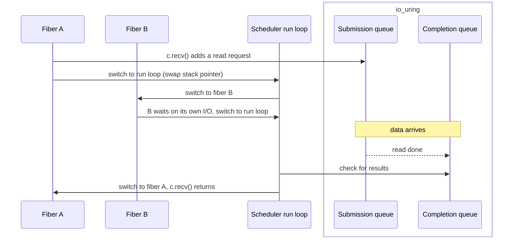

# coroutine runtime

A stackful coroutine runtime on Linux that lets you write plain blocking-style code in lightweight user threads.
They all share one OS thread. When a user thread waits for I/O, the others keep running, so one OS thread can serve many connections.

## Features
- Lightweight user threads (fibers) multiplexed on a single OS thread
- io_uring for socket and file I/O
- Timers (`c.sleep(duration)`)
- Go-inspired concurrency primitives: buffered channels, `select` over multiple channels, semaphores

## Limitations
- Single-threaded
- Channels must be buffered
- `select` only supports receive branches
- No cancellation support for now
- Fixed-size stack per fiber

## How: stack switching
Each user thread (fiber) has its own small stack. That stack holds every function the fiber is executing, with their local variables and return addresses.

Switching fibers means saving the current CPU's stack pointer register, then loading the ones saved for another fiber. The paused fiber's stack stays exactly as it was, so when the scheduler switches back, it carries on where it stopped.

I/O goes through [io_uring](https://unixism.net/loti/), a Linux async I/O interface. I/O requests are put in a submission queue, and the kernel puts results in a completion queue.

The scheduler keeps track of every fiber and whether it's ready or waiting. In the run loop, it runs each ready fiber until it yields, for example by starting I/O. Then it checks the completion queue and marks the fibers whose I/O finished as ready again.



The switch itself is about 20 lines of assembly per CPU architecture: push the callee-saved registers, swap the stack pointer, pop, then return ([x86-64](src/arch/x86_64.cpp), [aarch64](src/arch/aarch64.cpp)).

## Examples
A single-threaded echo server: [`examples/echo_server.cpp`](examples/echo_server.cpp)

```cpp
Context c;
c.spawn([](Context& c) {
    int listen_fd = /* socket() + bind() + listen() */;
    while (true) {
        int fd = c.accept(listen_fd, nullptr, nullptr, 0);   // parks this fiber, not the thread
        c.spawn([fd](Context& c) {                           // one fiber per connection
            char buf[4096];
            int n;
            while ((n = c.recv(fd, buf, sizeof buf, 0)) > 0) {
                c.send(fd, buf, n, MSG_NOSIGNAL);
            }
            c.close(fd);
        });
    }
});
c.run_loop();
```

More examples:
- Chat server: [`examples/chat_server.cpp`](examples/chat_server.cpp)
- HTTP file server: [`examples/http_server.cpp`](examples/http_server.cpp)

## Requirements
- Linux x86-64 or aarch64
- GCC, C++20
- liburing

## Build & run
```sh
make -j
./out/examples/chat_server   # test with `nc localhost 8080`
./out/examples/http_server . # test with `curl localhost:8080/README.md`
```

## Development
Generate `compile_commands.json` for clangd:
```sh
make clean && rm -f compile_commands.json && bear -- make all -j
```

On macOS or Windows, use the Docker dev image. It has to run with `--security-opt seccomp=unconfined`, because Docker's default seccomp profile blocks io_uring
```sh
make dev     # native arch (arm64 on Apple Silicon)
make dev-x86 # x86-64 under emulation. Compiles, but io_uring isn't available under Rosetta
```

## Acknowledgements
- [Tsoding](https://github.com/tsoding)'s [video on implementing Python-style `yield` with stack switching in assembly](https://youtu.be/uFET2vifHh4)
- [Lord of the io_uring](https://unixism.net/loti/), the io_uring guide
